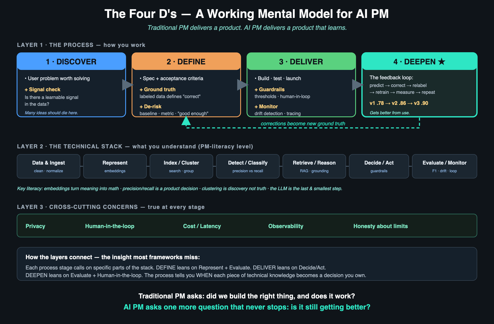

# The Four D's — A Working Mental Model for AI Product Management

> Traditional PM delivers a product. **AI PM delivers a product that learns.**

## New: the AI PM field guide

Start with [The AI PM Field Guide](docs/AI-PM-FIELD-GUIDE.md), organized around **Discover → Define → Deliver → Deepen**. Each stage explains the PM’s decisions, questions to investigate with ML/DS and engineering, and evidence to request. ProductSignal examples show how risk, evidence, policy, authority and feedback inform those decisions.

Use the [planning templates](docs/TEMPLATES.md) to structure collaboration and the [evaluation playbook](docs/EVALUATION-PLAYBOOK.md) to interpret technical evidence. Specialist implementation responsibilities are explicit throughout. The original framework and diagram remain below; the field guide qualifies their broader claims about learning and confidence.

---

Every PM knows the classic shape of the job: **Discover** the problem, **Define** the solution, **Deliver** it. That muscle still works for AI products. AI doesn't throw it out — it adds a wrinkle inside each step, and then adds one brand-new step at the end.

**Discover → Define → Deliver → Deepen.**

This is a working mental model, developed by building — not theory. It came out of two hands-on AI PM studies (links below), and each stage maps to a real decision made and a lesson learned.

---

## Explain it to me like I'm a PM who's new to AI

**You already know how to ship products.** AI adds wrinkles inside each familiar step, and one new step at the end.

**Discover gets one new question: "is this even learnable?"** In normal product work, if users want it and it's feasible, you build it. In AI there's a step before feasibility — does the data actually contain the pattern you're hoping the model will find? Sometimes the honest answer is no, and killing the idea early is a win, not a failure.

**Define is where the real AI work hides.** In normal software, "correct" is whatever the spec says. In AI, *you have to define what correct even means*, and you define it with examples, not rules — you label a pile of real cases as ground truth. Then you accept the system will never be 100% right, so you decide up front, as a number, how good is good enough. And you decide which kind of mistake you can live with, because you can't minimize both false alarms and misses at once.

**Deliver looks familiar but you ship it on a leash.** Because the output is a probability, not a certainty, high-confidence answers can run automatically while shaky ones route to a human. You watch for "drift" — the model slowly getting worse as the real world drifts from your training data. Normal monitoring says the server is up; AI monitoring says the model is still *right*.

**Deepen is the step that doesn't exist in normal PM.** A normal product is as good a year after launch as it was on day one, unless you ship new features. An AI product can get *better on its own* through a loop: it guesses, a human corrects the wrong ones, those corrections become new labeled examples, you retrain, and it improves on exactly the cases real users bring. Your job is to build that loop and prove it works by tracking the score climbing over versions.

**And underneath all of it, one hard-won truth:** the model is usually the least of your problems. When an AI product gives a dumb answer, people blame "the AI." But nine times out of ten the fault is upstream — messy data, a bad labeling call, the wrong context being retrieved. The model at the end just stitches together whatever the pipeline handed it. When something's wrong, look upstream first.

---

## The three layers

**Layer 1 — The Process (how you work):** Discover → Define → Deliver → Deepen. The first three you already know; Deepen is what AI adds.

**Layer 2 — The Technical Stack (what you understand):** Data → Represent → Index/Cluster → Detect/Classify → Retrieve/Reason → Decide/Act → Evaluate/Monitor. You don't implement these — you need enough fluency to ask the right questions and make tradeoffs.

**Layer 3 — Cross-Cutting Concerns (true everywhere):** Privacy · Human-in-the-loop · Cost/Latency · Observability · Honesty about limits.

**How they connect — the part most frameworks miss:** each process stage calls on specific parts of the technical stack. Define leans on *Represent* and *Evaluate*. Deliver leans on *Decide/Act*. Deepen leans on *Evaluate* and *Human-in-the-loop*. The process tells you *when* each piece of technical knowledge becomes a decision you own.

The full write-up with every stage detailed is in [FRAMEWORK.md](FRAMEWORK.md).

---

## The one thing to remember

Traditional PM asks: *did we build the right thing, and does it work?*

AI PM asks that — and then one more question that never stops:

**Is it still getting better?**

---

## Where this came from

This framework was distilled from two hands-on AI PM projects:

- **[Photo Intelligence](https://github.com/sde-agent/photos-project)** — a privacy-first, on-device blink detector with a live feedback loop. Went from a hardcoded threshold (F1=0.78) to a trained classifier that improves from corrections (F1=0.86 and climbing). This is where **Deepen** became concrete.
- **[ProductSignal](https://github.com/sde-agent/productsignal)** — a local support-case discovery system that finds distinct customer problems through clustering, without being given the answer labels. This is where **Discover** (signal check) and **Define** (product priorities before tuning) became concrete.

Built the systems first. The framework is what I understood afterward.
