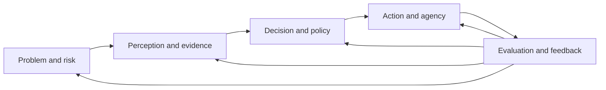
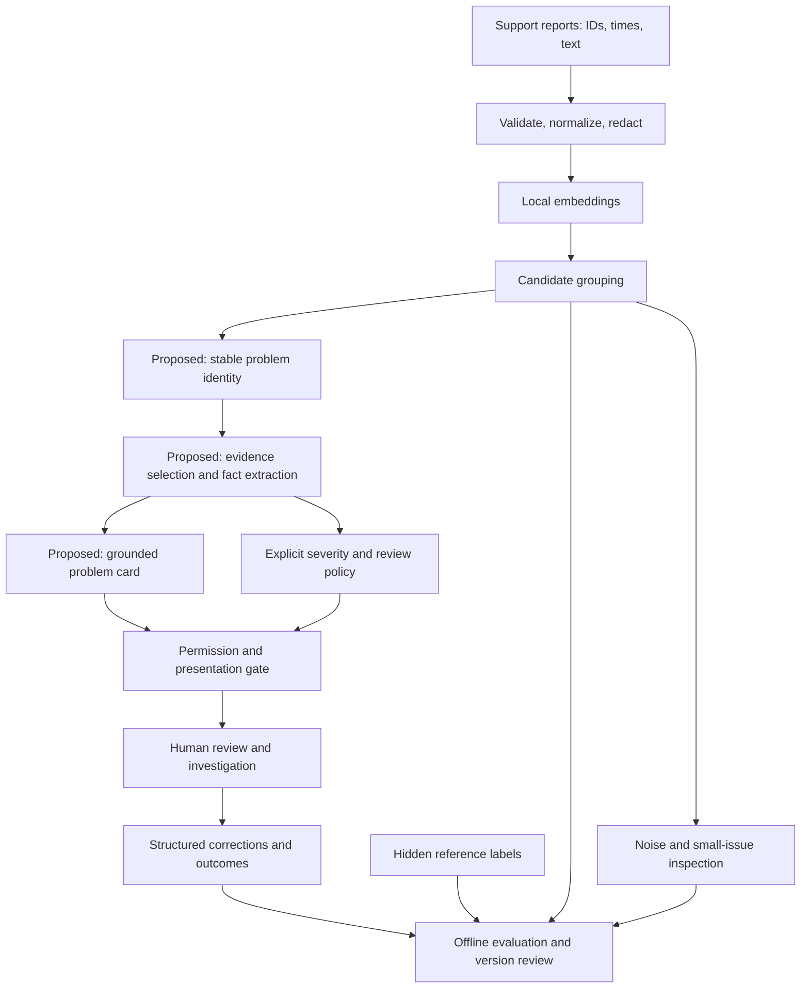
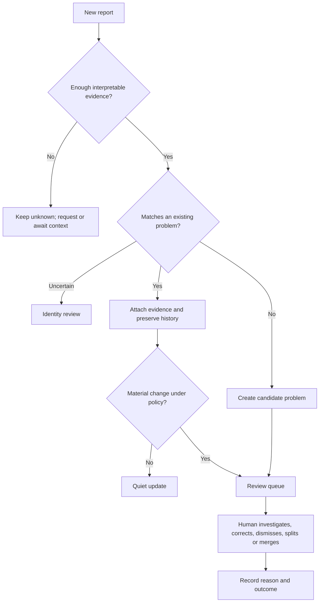

# The AI PM Field Guide

> An AI PM designs a system that turns incomplete evidence into useful decisions, within an explicit boundary of acceptable risk.

The job is bigger than choosing a model, writing prompts, or shipping a product that learns. It is deciding **what the system may believe, what that belief justifies, what it may do, and how we will know when it is wrong**.

ProductSignal made this tangible. Its purpose is to help a PM recognize a specific customer problem early enough to investigate, without creating an endless queue of repeated or misleading candidates. “Run clustering” is an implementation. “Show enough trustworthy evidence to begin investigating” is the capability. Earlier useful recognition is the intended outcome. These are three different claims, requiring three different tests.

## Read this as a working manual

- Start with [the mental model](#the-five-questions), then [the ProductSignal walkthrough](#productsignal-from-reports-to-review).
- Use [risk and policy](#risk-is-a-product-specification) before tuning models.
- Use [evaluation](#evaluate-the-chain-and-the-outcome) and [failure diagnosis](#diagnose-before-you-optimize) when a demo looks convincing.
- Take the [PRD and system-design templates](TEMPLATES.md) into planning. Use the [evaluation and trace playbook](EVALUATION-PLAYBOOK.md) during experiments and launch reviews.

This guide extends [the Four D’s](../FRAMEWORK.md). It preserves Discover, Define, Deliver, Deepen as a useful delivery process, along with technical literacy and cross-cutting concerns. The supplied Four D’s diagram shows those same layers. The added model describes reasoning **inside every stage**, rather than adding another stage to the calendar.

## The five questions

Think of an AI product as a controlled evidence-to-action loop. Ask all five questions whenever you change data, models, prompts, thresholds, workflow, or autonomy.

| Lens | Question the PM owns | Concrete artifact | ProductSignal example |
|---|---|---|---|
| **Problem / risk** | Which user decision should improve, and which mistakes hurt? | Outcome brief, loss table, non-goals | Recognize distinct emerging problems; protect small issues and PM attention |
| **Perception / evidence** | What can the system observe, and what does it actually support? | Data contract, evidence packet, uncertainty fields | Reports support an observed checkout failure, not proven root cause |
| **Decision / policy** | Given that evidence, what should happen? | Rubric, thresholds, exceptions, abstention policy | Present a review candidate; keep severity advisory |
| **Action / agency** | What is the system permitted to change? | Permission matrix, approval and recovery controls | Update a problem card; no automatic incident escalation |
| **Evaluation / feedback** | How will we detect failure and improve without fooling ourselves? | Held-out tests, traces, monitored outcomes | Measure clean coverage and repetition, then validate usefulness with PMs |

The arrows are dependencies, not a claim that every AI system needs every technical component. Classification may require no retrieval. A report generator may require no agent. A deterministic rule may be the right policy layer. Evaluation begins before implementation and continues after use.

**The boundary that matters:** a plausible interpretation is not automatically a justified decision; a justified decision is not automatically permission to execute it.

### How this fits the Four D’s

| Process stage | Apply the five questions | Exit evidence |
|---|---|---|
| Discover | Name the user decision; compare error costs; check whether relevant evidence exists | A worthwhile problem and testable capability hypothesis |
| Define | Specify observations, policy, authority, and evaluation separately | Draft contract, annotated examples, baseline and acceptance plan |
| Deliver | Build the chain; test each boundary; limit action authority | Reproducible quality evidence, usable workflow, operational controls |
| Deepen | Review failures and outcomes; change the relevant stage; revalidate | Demonstrated improvement on reserved cases and real use where available |

Feedback is not exclusive to Deepen. Nor does use automatically improve a system: corrections must be reviewed, changes versioned, and regressions tested. A retrieval fix or workflow change may outperform retraining. Conventional products also learn through experimentation; AI makes uncertain inference and its controls especially visible.

Treat “look upstream first” as a diagnostic habit, not a universal statistic. Bad inputs, retrieval, generation, policy, identity tracking, and tools can all fail. Raw model outputs are not necessarily probabilities, and an embedding score or HDBSCAN membership strength is not calibrated confidence that a customer problem is real.

## How an AI PM reasons

A useful thinking sequence is: **user decision → evidence needed → failure cost → permitted response → falsifiable test**.

Imagine two experiments. One produces tidy groups but discards a small search outage. The other splits a real issue across multiple groups. Asking “Which score is higher?” hides the product judgment. Asking “Which failure makes the important behavior unrecoverable?” reveals it. In ProductSignal V1, the user preferred fragmentation to over-merging, while putting preservation of meaningful small behaviors first.

That becomes an instruction to ML/DS: “Compare approaches that preserve distinct observed failures and small issues. Report misses, mixed groups, and fragmentation separately. Do not optimize aggregate purity at the expense of the product mission.” It does not dictate HDBSCAN.

Then ask whether a good group is a good product. If the same evidence repeatedly returns as a new candidate, recognition quality alone is insufficient. The PM must specify problem identity, meaningful updates, and a review budget. This is where AI PM thinking moves from a model leaderboard to a system design.

Use this decision record in meetings:

1. **Observation:** What happened, in which dataset or workflow?
2. **Interpretation:** Which explanation is supported? What alternatives remain?
3. **Decision:** What product or implementation choice follows?
4. **Boundary:** What has this evidence not established?
5. **Next test:** What result would change our decision?

For example: “This synthetic replay produced repeated candidates. Shared reports suggest identity tracking needs work, but do not prove every candidate is redundant. Hold grouping fixed and test one evolving problem card with material-change rules. Then ask PMs whether the evidence is useful.”

## ProductSignal: from reports to review

### The experience we were designing

> **Checkout stalls after address entry**  
> Three reports describe inability to continue to payment.  
> **Potential severity:** High; purchase completion is reportedly blocked.  
> **Evidence:** linked reports and excerpts.  
> **Unknown:** affected customer scope, workaround, and root cause.  
> **Status:** Needs review.

The PM can investigate, dismiss with a reason, request more evidence, or split/merge a candidate. Additional matching reports update the same problem. A notification needs a meaningful change, not merely a different cluster assignment.

This is a design target from the discussion, not a claim that the complete workflow is built or validated. Three distinct report IDs were an experimental evidence threshold, not three verified independent customers or a production launch criterion. Financial-harm reports may need review with fewer reports; low count is not low risk.

### Architecture: experiment versus proposed product

The established feasibility stack used local Ollama/nomic embeddings and HDBSCAN, with hidden labels reserved for evaluation. Severity was explored with Qwen2.5:14b and remained advisory. The stable identity, grounding, presentation, and feedback boxes describe the fuller system to design and validate; they should not be read as shipped functionality.

Reference labels must never enter model inputs, preprocessing features, retrieval context, policy execution, or online identity matching. For temporal replay, only reports and metadata available at the replay time may enter the system.

### What the experiments taught us

The [published development results](https://github.com/sde-agent/productsignal/blob/main/docs/results.md) document a candidate that retained nine of fifteen search-outage reports in a clean group. For promo freeze, 21/25 cases escaped noise, but only 15/25 were in clean groups; six were mixed with other failures. Assigned coverage of 84% was therefore not clean coverage of 60%. The model preserved some small behaviors, while still missing and mixing cases. These are synthetic development findings, not deployment performance.

In the subsequent conversation’s synthetic timeline replay, a clean checkout group appeared 44 hours before an **assigned comparison recognition time**; duplicate charges appeared 14 hours before its assigned time, and search gained no lead. Changing the invented comparison changes the apparent benefit. This checks mechanics, not real team time savings.

Candidate tracking recorded 101 presentations after setup, 77 with links to earlier groups. Of these, 86 contained background reports only. Background does not mean useless; shared evidence does not establish redundancy. The pattern nevertheless exposed a requirement worth testing: separate a new problem from more evidence about an existing problem. No alerts were sent, and no measured PM review burden followed from those counts.

The severity development check matched 9/12 human judgments. All three errors downgraded Medium to Low when a functional failure had a recovery or alternative path. Correct quotes and valid JSON did not establish faithful policy application. This motivates separating extracted facts from explicit severity rules and evaluating both.

### The next product flow

Material change might mean newly reported financial harm, a different affected function, stronger independent evidence, or a meaningful rate change. Each requires an explicit rule, a comparison window, and tests. A cluster ID is an experiment artifact, not a durable incident ID. Splits and merges must preserve provenance and allow reversal.

## Risk is a product specification

### Asymmetric mistakes

| Failure | User cost | ProductSignal response to design |
|---|---|---|
| Small issue disappears into noise | Emerging behavior remains invisible | Audit noise; report small-issue recall; consider a separate review route |
| Distinct failures merge | Misleading story; wrong investigation | Preserve behavioral distinctions and citations; allow split |
| One issue fragments | Duplicate review; diluted counts | Tolerate initially; reconcile identity without destroying evidence |
| Severity understated | Harm may be delayed or ignored | High-cost slices, conservative human review, explicit Unknown |
| Every regrouping looks new | PM attention is consumed | Durable identity, quiet updates, notification budget |
| Card implies root cause without evidence | Investigation starts from a false premise | Separate observation, hypothesis, and verified fact |

Do not collapse these into one accuracy number. Set minimum safeguards for high-cost errors, then optimize usefulness, speed, and cost within them. If you use a weighted loss, document who assigned the weights and examine sensitivity. A weighted average must not conceal a catastrophic slice failure.

For a simple binary review decision, with calibrated probability p that review is warranted, review when the expected cost of skipping (p × miss cost) exceeds the expected false-review cost ((1−p) × false-review cost), subject to review capacity and hard safety rules. This is a decision aid, not a threshold justified by arbitrary confidence. Probability calibration, uncertain costs, and scarce reviewer capacity all need examination.

### Perception versus policy

Perception extracts what the report says: affected function, observed failure, blocked task, demonstrated recovery, reported financial harm, and evidence spans. Policy maps those facts to a response. Separating them makes disagreement diagnosable.

The discussion’s severity rubric was:

- **High:** purchase/account access remains blocked, or specific financial harm is reported.
- **Medium:** a function fails or degrades, with demonstrated recovery restoring purchase/account access.
- **Low:** minor friction or preference without functional failure.
- **Unknown:** insufficient context to identify the task and impact.

These are contextual product definitions, not universal severity standards. Define precedence for overlapping facts and ambiguous alternatives. Browsing around broken search does not erase a search failure. “Refresh fixed checkout” does not make the failure cosmetic. Reported financial harm justifies review without proving a duplicate settlement occurred.

A deterministic policy engine improves inspectability, but can still be wrong if extracted facts are wrong or the rubric is incomplete. Evaluate fact extraction, rule coverage, final labels, abstention, and downstream action separately.

## Design the evidence layer

### Data contracts before embeddings

Agree on source ID, event and ingestion time, text, language, product version, channel, permissions, retention, and optional account identity. Preserve originals under appropriate access controls; retain normalized-to-original offsets for evidence quotes. Remove signatures and boilerplate without deleting negation, symptom details, recovery, or uncertainty.

Distinguish report deduplication from independent customer evidence. Multiple tickets can come from one customer, one copied template, or an automated integration. Missing identity must remain unknown. Count reports, known distinct accounts, and unknown-account reports separately. Never label a report count as affected-customer count.

Inspect samples before tuning: ambiguous complaints, multi-issue reports, rare failures, changing vocabulary, non-English cases, copied text, and missing timestamps. Synthetic templates help expose known failure mechanisms but may make semantic grouping artificially easy. Real permissioned data is needed to validate generalization.

### Retrieval and grounding

If a card uses retrieval, define what is being retrieved: reports for a candidate, representative examples, contradictory cases, prior problem cards, or product documentation. Each has different relevance and freshness requirements. Filter authorization before similarity search and again before rendering evidence.

Measure whether necessary evidence was available, retrieved, selected into context, and used faithfully. More context can introduce conflicting behaviors or crowd out rare evidence. Use diverse samples, not only central examples; include boundary reports and counterevidence. A citation must resolve to the specific supporting span, not merely a related document.

For each generated claim, retain its source IDs and spans. Validate quoted text against the source; label deductions as hypotheses; expose missing context. Reject or regenerate unsupported claims rather than hiding weak evidence behind confident prose. Retrieved content is data, including any instructions inside it. It cannot expand tool permissions or change policy.

### Confidence is several uncertainties

Track uncertainty about report interpretation, group identity, evidence sufficiency, severity policy, and action eligibility separately. A single confidence badge can mislead. Calibrate a probability only against a defined outcome on representative reserved data; measure reliability by score bin and slice. Do not present cosine similarity, membership strength, or a model’s verbal confidence as that probability.

## Decide how much agency to grant

| Authority | Example | Required controls |
|---|---|---|
| Observe | Read authorized reports | Scoped access, retention and privacy rules |
| Suggest | Draft a problem card | Evidence links, Unknown, human correction |
| Organize | Attach reports or update status | Auditable identity changes, undo, deduplication |
| Execute with approval | Create an investigation ticket | Preview exact payload; approval bound to that payload |
| Execute automatically | Trigger a bounded workflow | Validated policy, tool allowlist, budgets, idempotency, recovery |

ProductSignal’s demonstrated severity checks justify advisory use, not automatic alerts. Raising autonomy requires evidence about the proposed action and its risks, not simply a better language-model score.

For agents, specify allowed tools and resources, maximum steps, time and spend limits, retry rules, stop conditions, and escalation. Enforce permission outside the model. Use idempotency keys for external writes, distinguish timeout from confirmed failure, and verify actual tool results before claiming completion. Log approvals and reject attempts to execute a modified payload under an old approval. Test prompt injection in reports, tool misuse, partial execution, and recovery.

## Evaluate the chain and the outcome

Use four levels of evidence:

1. **Contract checks:** schemas, provenance, hidden-label separation, quote integrity, permissions.
2. **Stage quality:** extraction, grouping, retrieval, policy application, identity and tool correctness.
3. **Workflow quality:** usable cards, actionable candidates, repeated presentations, review effort and correction burden.
4. **Product outcome:** earlier useful recognition and investigation, measured against a credible existing process.

A good score at one level is not proof of the next. A synthetic replay establishes mechanics under assumptions. A held-out historical replay estimates performance on that history. Shadow use tests real inputs without consequences. A supervised pilot can test review usefulness and operational burden. Strong causal claims about time saved require a credible comparison, with confounders and selection effects considered.

See the [playbook](EVALUATION-PLAYBOOK.md) for denominators, slices, traces, judge calibration, and release gates. Choose thresholds after inspecting baselines and reviewing costs, then freeze them before reserved evaluation. Track both quality and coverage: abstaining on every difficult case can make apparent precision excellent while delivering little value.

### Calibrate the judge, too

An LLM judge is another imperfect component. Write a concrete rubric, independently annotate a representative sample, adjudicate disagreement, then compare judge judgments with the human reference by class and high-risk slice. Separate disagreement about facts from disagreement about policy. Test sensitivity to wording, order, verbosity, and evaluator model changes. Track judge versions and periodically recheck agreement.

Do not let the generator grade its own prose without independent checks. Prefer deterministic checks for source existence, exact quotes, schema and permissions. Use judges for semantic properties that require judgment, and humans for unresolved or high-cost cases. Freeze evaluation examples apart from prompt-development cases; hidden labels do not make repeatedly tuned-on data a test set.

## Diagnose before you optimize

| Symptom | Inspect first | Targeted experiment |
|---|---|---|
| Vague “authentication issue” | Mixed source behaviors; evidence sampling | Hold synthesis fixed; compare grouping and boundary cases |
| Missing small outage | Noise bucket, vocabulary, density assumptions | Audit rare cases; compare simpler retrieval/rule baseline |
| Wrong severity with correct quotes | Extracted facts and rubric precedence | Fixed facts into policy; fixed policy across extraction models |
| Repeated problem cards | Identity match and material-change rules | Replay with grouping fixed; inspect split/merge history |
| Unsupported root cause | Claim-to-source mapping and prompt | Evaluate abstention and hypothesis labeling |
| Slow or expensive system | Stage latency, context size, retries | Cache, batch, bound context; compare quality at equal budgets |
| Offline pass, production failure | Distribution, missing fields, language, feedback delay | Slice real traffic and re-evaluate under observed conditions |

Change one explanatory variable at a time when practical. Compare versions on the same reserved cases, include variance or interval estimates where appropriate, and inspect changed outcomes. Stop when the current phase’s question is answered; unresolved gaps can be the output of feasibility work. The ProductSignal discussion explicitly stopped severity iteration to avoid turning exploration into endless prompt edits. Those edits were prompt/configuration iteration, not model-weight fine-tuning.

## Implementation tradeoffs a PM should understand

| Choice | Useful when | Cost or limitation | Decision evidence |
|---|---|---|---|
| Keyword/rule baseline | Known clear behaviors | Brittle to paraphrases; misses novelty | Measured misses and review load |
| Known-issue classifier | Stable categories and labels | Unknown behaviors can be forced into known classes | Unknown detection and new-issue slices |
| Embeddings + clustering | Discovering repeated semantic patterns | Similarity can blur distinct failures; density misses rare issues | Clean coverage, confusion pairs, noise audit |
| Hybrid grouping | Known issues plus novel candidates | More components and routing complexity | End-to-end gains beyond each baseline |
| Local models | Data locality and controlled infrastructure | Hardware limits, slower inference, operations | Real quality, latency and operational budget |
| Hosted models | Capability or infrastructure advantages | Data handling, network dependence, variable costs | Approved data policy and equal-workload comparison |
| Larger model | Complex extraction or reasoning | More memory and latency; no guaranteed policy fidelity | Reserved task-specific eval at equal constraints |
| Explicit rules after extraction | Stable policy requiring audit | Extraction mistakes remain; exceptions grow | Fact quality and policy boundary coverage |
| Fine-tuning | Persistent measured task gaps with suitable data | Labeling, training, deployment and regression cost | Improvement beyond retrieval/prompt/rule baselines |

For a local or zero-egress claim, inspect all data paths: model calls, embeddings, telemetry, tracing, updates, and external tools. Local inference alone does not establish privacy. Cache keys should include input and transformation/model versions; stale embeddings can silently corrupt a comparison.

## Phase gates: how to avoid endless prework

| Phase | PM input and decision | ML/DS or engineering output | Move forward when |
|---|---|---|---|
| 0. Brief and draft spec | User decision, outcome, error priorities | Data audit and feasible options | Problem and evidence hypothesis are testable |
| 1. Capability feasibility | Distinctions worth preserving | Baselines, grouping/extraction evals, traces | Mechanism is promising or limitations are decisive |
| 2. Timing and workflow feasibility | Useful candidate, update and review definitions | Chronological replay, identity and queue experiments | Evidence supports designing a workflow; assumptions are explicit |
| 3. Informed PRD | Scope, acceptance thresholds, authority | Contracts, architecture, eval and rollout plan | Product and safety acceptance are reviewable |
| 4. Product build | UX choices and exception handling | Evidence cards, review controls, instrumentation | Complete chain works under failure conditions |
| 5. Validation | Launch criteria and unresolved risks | Reserved tests, adversarial checks, user studies | Criteria pass or scope is reduced |
| 6. Supervised pilot | Review capacity, comparison plan | Shadow/pilot observations and incidents | Useful outcomes and manageable burden are demonstrated |
| 7. Rollout and improvement | Autonomy increments and monitoring response | Versioned releases, feedback review, rollback | Each expansion has evidence and an accountable owner |

These gates loop when evidence changes. The PRD starts in phase 0 and becomes more informed; experimentation does not replace product definition. For ProductSignal, capability feasibility was packaged, and the later synthetic timing work exposed workflow requirements. Real time savings, production acceptance and a completed pilot remain unestablished.

## Take this into your next design review

Ask: What user decision improves? What evidence is required? What must stay Unknown? Which mistake is costlier? Which stage owns that failure? What action is permitted? What comparison could falsify the value claim? What trace lets us reconstruct a bad result? What is this phase’s stopping rule?

An interview-ready description of ProductSignal is: “I translated early problem recognition into evidence and error requirements. We prioritized preserving small behaviors and avoiding over-merging, evaluated clean coverage rather than only assigned coverage, kept severity advisory after policy-boundary failures, and used synthetic replay to discover identity and review requirements. We did not claim production accuracy or real time savings.”

## Sources and scope

- [Original framework](../FRAMEWORK.md) and its supplied diagram: reviewed as the starting process and literacy model; preserved in this change.
- [ProductSignal repository](https://github.com/sde-agent/productsignal) and [recorded development results](https://github.com/sde-agent/productsignal/blob/main/docs/results.md): public support for the capability and severity findings.
- ProductSignal design conversation, October 6, 2026: supports the error-priority decision, synthetic timing/tracking findings, draft card, and stopping-rule lessons. Timing details are conversation-reported, not independently rerun for this guide.

The fuller architecture, controls, templates and release plan are recommendations derived from those lessons. They are not claims of existing ProductSignal implementation. Numerical examples in the companion playbook are definitions or proposed tests unless explicitly identified as recorded results.
