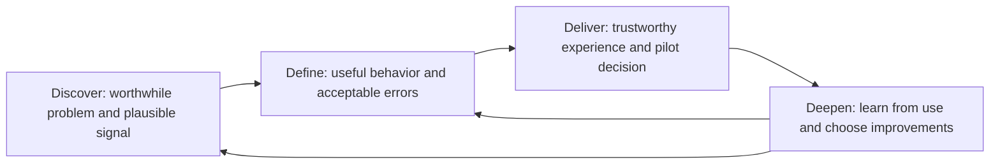
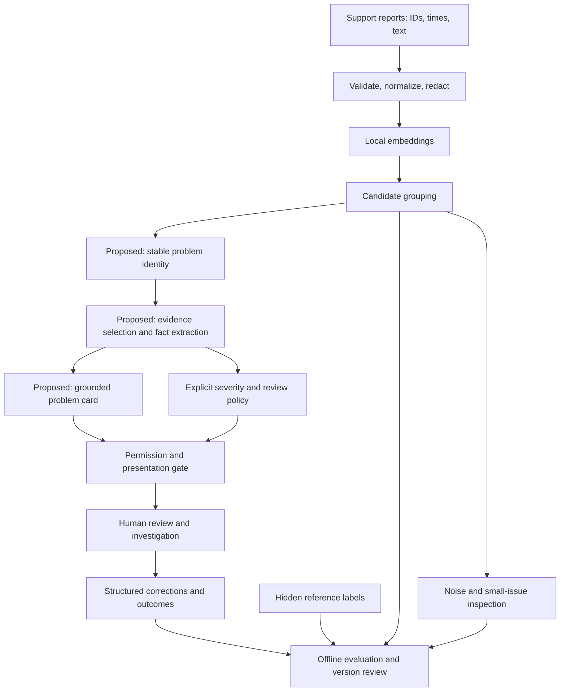
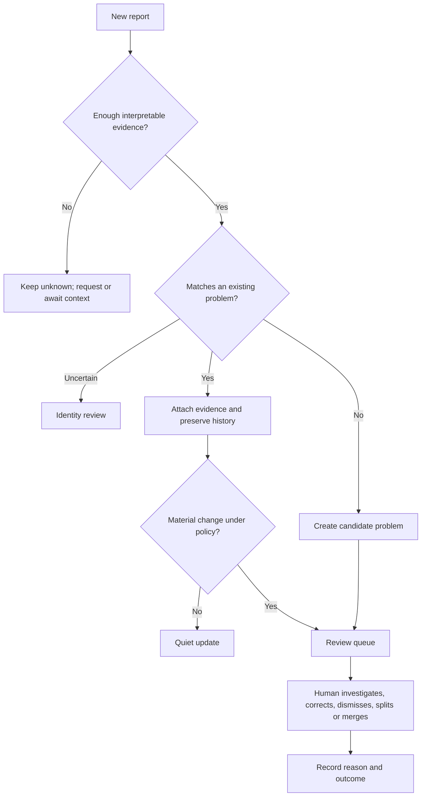

# The AI PM Field Guide: Discover, Define, Deliver, Deepen

> The AI PM owns the user problem, product tradeoffs, and evidence needed to make a decision. ML/DS and engineering own the technical work that produces that evidence and delivers the capability.

You need enough technical understanding to ask good questions, challenge an unsupported conclusion, and make informed decisions with your counterparts. Your job usually does not include implementing clustering, building retrieval indexes, calibrating an evaluator, or operating model infrastructure. Team boundaries vary, especially in small teams; agree on them explicitly.

**Use the Four D’s as the main structure:** Discover the worthwhile problem; Define useful behavior and acceptable errors; Deliver a trustworthy experience; Deepen through evidence from use. The questions about risk, evidence, policy, authority, and feedback sit inside these stages. They are not another process to memorize.

ProductSignal makes this concrete. “Run clustering” is a technical approach. “Show a specific customer problem with enough evidence to investigate” is a product capability. “Help a PM recognize it earlier without endless repeated reviews” is the intended outcome. The PM defines the latter two and asks ML/DS to compare ways to achieve them.

## The Four D’s at a glance

| Stage | PM decision | Questions for ML/DS or engineering | Evidence to request |
|---|---|---|---|
| **Discover** | Is this problem worth pursuing, and is the capability plausible? | Does the data contain the distinctions users care about? What can a simple baseline do? | Data samples, feasibility findings, limitations and alternatives |
| **Define** | What is useful, which errors matter, and what may the system do? | Can we preserve small issues without mixing distinct failures? How will you test our requirements? | Worked examples, error breakdowns, evaluation plan and workflow proposal |
| **Deliver** | Is the whole experience ready for a supervised pilot? | Can users inspect evidence, correct mistakes and avoid repetitive review? What happens on failure? | End-to-end demonstrations, reserved evaluation, user testing and operational readiness |
| **Deepen** | What should improve next, and did the change help? | Where do failures originate? Are quiet or missed cases being examined? Did the change regress another group? | Structured feedback, diagnosed failures, version comparisons and user outcomes |

Read the stages below in order. Use [the planning templates](TEMPLATES.md) for conversations and decisions, and [the evaluation playbook](EVALUATION-PLAYBOOK.md) to understand evidence your technical counterparts provide. The [original framework](../FRAMEWORK.md) and diagram remain the foundation.

## Discover — decide whether this is worth pursuing

### Your product work

Understand the current workflow, the costly decision or delay, and the improvement users would value. Frame a capability hypothesis before choosing an algorithm. Investigate data availability and whether the proposed capability is plausible with ML/DS.

For ProductSignal: “Can we connect reports about the same customer-observed problem and help a PM recognize it earlier?” The discovery question is not “Can we tune HDBSCAN?”

### Questions to investigate with ML/DS

| Ask | Why it matters | Evidence to request | Decision it enables |
|---|---|---|---|
| Can these reports distinguish search unavailable from irrelevant results? | Similar vocabulary can conceal different user problems | Representative samples and baseline errors | Whether the proposed capability is plausible |
| Which important cases are rare, ambiguous or missing? | Common themes can dominate aggregate results | Data audit and small-issue examples | Scope and feasibility limits |
| Could rules or known-issue classification be sufficient? | Complexity must earn its value | Practical baseline comparison | Which approach deserves further exploration |
| What does synthetic data establish here? | An invented scenario cannot prove real customer benefit | Explicit assumptions and claim boundaries | Whether to proceed to real-data or workflow validation |

**Your output:** an outcome brief, non-goals, preliminary error priorities, and a bounded feasibility question. **Counterpart output:** a data audit, options and mechanism evidence. **Move forward when:** there is enough evidence to design the next test, or enough evidence to stop. A promising mechanism does not establish business value.

## Define — decide what good means

### Your product work

Specify what the user sees and can do, what counts as useful evidence, which mistakes hurt most, what remains Unknown, and what requires human judgment. Work with ML/DS on metrics that reflect those choices. They design and run the technical evaluation; you challenge whether its results justify the product decision.

ProductSignal’s priorities were: preserve meaningful small behaviors; avoid merging distinct failures; then reduce fragmentation. The user chose those priorities. ML/DS translate them into comparisons, not the other way around.

### Questions to investigate with your counterparts

| Ask | Evidence to request | PM decision |
|---|---|---|
| Are we retaining meaningful small issues, or merely improving average purity? | Small-issue recall, noise examples and behavior-level breakdowns | Whether the approach respects the product mission |
| How many retained reports remain in mixed groups? | Clean versus assigned coverage and confusion-pair examples | Whether the evidence is specific enough to investigate |
| Does the severity policy preserve functional failure when recovery exists? | Boundary cases, extracted facts and final judgments | Rubric clarification and whether severity stays advisory |
| What warrants a new card versus an update? | Proposed identity behavior and repeated-presentation examples | Review experience and attention budget |
| What does each confidence score actually mean? | Definition, validation and uncertainty limitations | What users may rely on and when to require review |

### Make error costs and policy explicit

#### Asymmetric mistakes

| Failure | User cost | ProductSignal response to design |
|---|---|---|
| Small issue disappears into noise | Emerging behavior remains invisible | Ask ML/DS which small issues were missed; decide whether a separate review route is needed |
| Distinct failures merge | Misleading story; wrong investigation | Require distinct observed behaviors and inspectable evidence; decide correction UX |
| One issue fragments | Duplicate review; diluted counts | Choose tolerance; ask engineering how related cards can be reconciled |
| Severity understated | Harm may be delayed or ignored | High-cost slices, conservative human review, explicit Unknown |
| Every regrouping looks new | PM attention is consumed | Durable identity, quiet updates, notification budget |
| Card implies root cause without evidence | Investigation starts from a false premise | Separate observation, hypothesis, and verified fact |

Ask ML/DS to report these errors separately rather than collapsing them into one accuracy number. Set minimum safeguards for high-cost errors, then optimize usefulness, speed, and cost within them. If you use a weighted loss, document who assigned the weights and examine sensitivity. A weighted average must not conceal a catastrophic slice failure.

Technical literacy for the discussion: for a simple binary review decision, with calibrated probability p that review is warranted, review when the expected cost of skipping (p × miss cost) exceeds the expected false-review cost ((1−p) × false-review cost), subject to review capacity and hard safety rules. This is a decision aid, not a threshold justified by arbitrary confidence. Probability calibration, uncertain costs, and scarce reviewer capacity all need examination.

#### Facts and product policy

Perception extracts what the report says: affected function, observed failure, blocked task, demonstrated recovery, reported financial harm, and evidence spans. Policy maps those facts to a response. Separating them makes disagreement diagnosable.

The discussion’s severity rubric was:

- **High:** purchase/account access remains blocked, or specific financial harm is reported.
- **Medium:** a function fails or degrades, with demonstrated recovery restoring purchase/account access.
- **Low:** minor friction or preference without functional failure.
- **Unknown:** insufficient context to identify the task and impact.

These are contextual product definitions, not universal severity standards. Define precedence for overlapping facts and ambiguous alternatives. Browsing around broken search does not erase a search failure. “Refresh fixed checkout” does not make the failure cosmetic. Reported financial harm justifies review without proving a duplicate settlement occurred.

A deterministic policy engine improves inspectability, but can still be wrong if extracted facts are wrong or the rubric is incomplete. Ask ML/DS to show whether errors arise in fact extraction, rule coverage, final labels or downstream actions. Their evaluation should distinguish these; the PM decides what the errors mean for the product.

### Define the ProductSignal experience

#### What the PM specifies

> **Checkout stalls after address entry**  
> Three reports describe inability to continue to payment.  
> **Potential severity:** High; purchase completion is reportedly blocked.  
> **Evidence:** linked reports and excerpts.  
> **Unknown:** affected customer scope, workaround, and root cause.  
> **Status:** Needs review.

The PM can investigate, dismiss with a reason, request more evidence, or split/merge a candidate. Additional matching reports update the same problem. A notification needs a meaningful change, not merely a different cluster assignment.

This is a design target from the discussion, not a claim that the complete workflow is built or validated. Three distinct report IDs were an experimental evidence threshold, not three verified independent customers or a production launch criterion. Financial-harm reports may need review with fewer reports; low count is not low risk.

#### Architecture to review with engineering

The established feasibility stack used local Ollama/nomic embeddings and HDBSCAN, with hidden labels reserved for evaluation. Severity was explored with Qwen2.5:14b and remained advisory. The stable identity, grounding, presentation, and feedback boxes describe the fuller system to design and validate; they should not be read as shipped functionality.

Ask ML/DS to demonstrate that hidden reference labels do not enter the system and that replay uses only evidence available at each checkpoint. They implement those protections. You need this assurance to interpret the experiment honestly.

#### Evidence the PM interprets

The [published development results](https://github.com/sde-agent/productsignal/blob/main/docs/results.md) document a candidate that retained nine of fifteen search-outage reports in a clean group. For promo freeze, 21/25 cases escaped noise, but only 15/25 were in clean groups; six were mixed with other failures. Assigned coverage of 84% was therefore not clean coverage of 60%. The model preserved some small behaviors, while still missing and mixing cases. These are synthetic development findings, not deployment performance.

In the subsequent conversation’s synthetic timeline replay, a clean checkout group appeared 44 hours before an **assigned comparison recognition time**; duplicate charges appeared 14 hours before its assigned time, and search gained no lead. Changing the invented comparison changes the apparent benefit. This checks mechanics, not real team time savings.

Candidate tracking recorded 101 presentations after setup, 77 with links to earlier groups. Of these, 86 contained background reports only. Background does not mean useless; shared evidence does not establish redundancy. The pattern nevertheless exposed a requirement worth testing: separate a new problem from more evidence about an existing problem. No alerts were sent, and no measured PM review burden followed from those counts.

The severity development check matched 9/12 human judgments. All three errors downgraded Medium to Low when a functional failure had a recovery or alternative path. Correct quotes and valid JSON did not establish faithful policy application. This motivates separating extracted facts from explicit severity rules and evaluating both.

#### Product behavior to agree before implementation

Material change might mean newly reported financial harm, a different affected function, stronger independent evidence, or a meaningful rate change. Each requires an explicit rule, a comparison window, and tests. A cluster ID is an experiment artifact, not a durable incident ID. Splits and merges must preserve provenance and allow reversal.

**Define exit:** a draft PRD, examples of useful and unacceptable outputs, agreed error priorities, human-review boundaries, and an evaluation plan. Avoid arbitrary launch numbers before seeing a baseline; agree and freeze final criteria before reserved evaluation.

## Deliver — decide whether the complete experience is ready

### Your product work

Review the whole journey with design, ML/DS and engineering. A good cluster is not yet a usable card; a usable card is not yet useful investigation. Decide pilot scope, authority, review capacity and acceptance criteria. Your counterparts build the system and demonstrate its quality, controls and failure behavior.

### Questions to investigate before a pilot

| Ask | Evidence to request | PM decision |
|---|---|---|
| Can a PM identify a specific problem and inspect supporting reports? | End-to-end cards and user observation | Whether the workflow is useful |
| Does new evidence update an existing problem without unnecessary interruption? | Replay and identity-change examples | Notification and review policy |
| What happens when evidence is missing, contradictory or inaccessible? | Failure demonstrations and permission checks | Fallback experience and pilot scope |
| How good is this on fresh examples, including costly mistakes? | Reserved evaluation with high-risk slices | Launch readiness or reduced scope |
| Is review demand manageable? | Measured queue volume and review effort | Pilot staffing and attention budget |
| What happens if an external action partially succeeds? | Engineering’s recovery demonstration | Permitted automation and escalation |

### Decide authority; ask engineering to demonstrate enforcement

| Authority | Example | Required controls |
|---|---|---|
| Observe | Read authorized reports | Scoped access, retention and privacy rules |
| Suggest | Draft a problem card | Evidence links, Unknown, human correction |
| Organize | Attach reports or update status | Auditable identity changes, undo, deduplication |
| Execute with approval | Create an investigation ticket | Preview exact payload; approval bound to that payload |
| Execute automatically | Trigger a bounded workflow | Validated policy, tool allowlist, budgets, idempotency, recovery |

ProductSignal’s demonstrated severity checks justify advisory use, not automatic alerts. Raising autonomy requires evidence about the proposed action and its risks, not simply a better language-model score.

Ask engineering: “Which tools and resources can the system access? Can it be stopped? What bounds its time and spending? Can retries create duplicate actions? How is approval enforced if a payload changes?” Request demonstrations of denied actions, malicious instructions in reports, partial execution and recovery. Engineering owns the mechanisms, including permissions, idempotency and verification. You decide the permitted product behavior and whether the demonstrated controls justify it.

### Ask for evidence at the right level

Ask your counterparts to distinguish four levels of evidence:

1. **Contract checks:** schemas, provenance, hidden-label separation, quote integrity, permissions.
2. **Stage quality:** extraction, grouping, retrieval, policy application, identity and tool correctness.
3. **Workflow quality:** usable cards, actionable candidates, repeated presentations, review effort and correction burden.
4. **Product outcome:** earlier useful recognition and investigation, measured against a credible existing process.

A good score at one level is not proof of the next. A synthetic replay establishes mechanics under assumptions. A held-out historical replay estimates performance on that history. Shadow use tests real inputs without consequences. A supervised pilot can test review usefulness and operational burden. Strong causal claims about time saved require a credible comparison, with confounders and selection effects considered.

See the [playbook](EVALUATION-PLAYBOOK.md) for denominators, slices, traces, judge calibration, and release gates. Choose thresholds after inspecting baselines and reviewing costs, then freeze them before reserved evaluation. Track both quality and coverage: abstaining on every difficult case can make apparent precision excellent while delivering little value.

#### Ask how the evaluator was validated

An LLM judge is another imperfect component. Ask ML/DS: “Who defined the rubric? How well does the evaluator agree with human reviewers? Where does it falsely approve high-risk outputs? Does wording or verbosity change its judgment?” Request a calibration summary and disagreement examples. The PM clarifies product expectations; ML/DS own calibration and evaluator validation, with domain reviewers contributing reference judgments.

Ask what independent checks support the quality claim: source integrity, human review, semantic judging and fresh evaluation cases. ML/DS and engineering choose and implement appropriate checks. Your decision is whether the evidence is credible enough for the proposed use. Hidden labels do not turn repeatedly tuned-on examples into an independent test set.

**Deliver exit:** a usable experience, credible fresh-case results, agreed pilot scope, demonstrated controls and named operational owners. Engineering owns implementation and operations; the PM owns the product recommendation with those partners.

## Deepen — decide what to improve from use

### Your product work

Study user corrections, ignored cards, review burden and outcomes. Prioritize the failures that most undermine the product goal. Ask counterparts to locate their causes and compare remedies. Decide whether an improvement earns broader rollout or more autonomy.

Feedback does not automatically improve a system. Ask how corrections are reviewed, what changes are proposed, and whether they improve reserved cases and real use. Conventional products learn too; Deepen makes the continuing quality responsibility explicit here.

| Ask ML/DS or engineering | Evidence to request | PM decision |
|---|---|---|
| Are users dismissing false problems, already-known problems, or poorly evidenced cards? | Structured reasons and reviewed examples | Which product requirement needs attention |
| Are we examining missed and quiet cases as well as surfaced ones? | Sampling plan and unseen-failure examples | Whether feedback is representative |
| Which stage explains the costly errors? | Diagnosed cases and concise trace walkthroughs | Improvement priority |
| Did the proposed change help without harming another behavior? | Version comparison on reserved cases and relevant slices | Release or further investigation |
| Are users recognizing useful problems earlier at acceptable effort? | Measured workflow outcomes with credible comparison | Whether the product value hypothesis is supported |

### Ask for diagnosis before requesting a bigger model

| Symptom the PM sees | Ask counterparts to inspect | Evidence or comparison to request |
|---|---|---|
| Vague “authentication issue” | Mixed source behaviors; evidence sampling | Hold synthesis fixed; compare grouping and boundary cases |
| Missing small outage | Noise bucket, vocabulary, density assumptions | Audit rare cases; compare simpler retrieval/rule baseline |
| Wrong severity with correct quotes | Extracted facts and rubric precedence | Fixed facts into policy; fixed policy across extraction models |
| Repeated problem cards | Identity match and material-change rules | Replay with grouping fixed; inspect split/merge history |
| Unsupported root cause | Claim-to-source mapping and prompt | Evaluate abstention and hypothesis labeling |
| Slow or expensive system | Stage latency, context size, retries | Cache, batch, bound context; compare quality at equal budgets |
| Offline pass, production failure | Distribution, missing fields, language, feedback delay | Slice real traffic and re-evaluate under observed conditions |

Ask ML/DS to explain what changed, why that comparison is informative, and whether the improvement holds on reserved examples. They design appropriate experiments and uncertainty estimates; you assess the product implications. Stop when the current phase’s question is answered; unresolved gaps can be the output of feasibility work. The ProductSignal discussion explicitly stopped severity iteration to avoid turning exploration into endless prompt edits. Those edits were prompt/configuration iteration, not model-weight fine-tuning.

## Technical literacy: questions to bring into the Four D’s

Use this reference when a technical choice affects a product decision. You do not need to run every procedure yourself or ask every question in every meeting. Focus on the decision at hand.

| Topic | Mainly relevant in | Questions for your counterparts | Evidence and PM decision |
|---|---|---|---|
| Data quality and privacy | Discover, Define | Are reports representative and authorized? Could normalization remove negation or recovery? Do counts represent reports or independent customers? | Sample audit and limitations; decide scope and truthful presentation |
| Embeddings and grouping | Discover, Define | Do semantic similarities preserve distinct failures? What happens to rare issues and noise? | Behavior-level errors; decide whether capability requirements are met |
| Retrieval | Define, Deliver | Did necessary evidence reach the answer? Were contradictory cases excluded? Are sources fresh and authorized? | Retrieval misses and examples; decide evidence sufficiency |
| Grounding | Define, Deliver | Can every factual claim be checked against a supporting span? How are hypotheses and unknowns shown? | Unsupported-claim examples; decide presentation and trust requirements |
| Confidence | Define, Deliver | What does the score mean? Is it validated for this outcome? Where does it mislead? | Calibration or explicit limits; decide reliance and review boundaries |
| Judge calibration | Deliver, Deepen | Does the evaluator agree with human judgments on costly errors? | Disagreement analysis; decide whether quality evidence is credible |
| Agent controls | Define, Deliver | What can the system change, and how are permissions, approval and recovery enforced? | Failure demonstrations; decide permitted authority |
| Traces and monitoring | Deliver, Deepen | Can you reconstruct a bad result and detect changes in quality? Who responds? | Trace walkthrough and response ownership; decide readiness and improvement priorities |

“Look upstream first” is a useful question, not proof that the model is rarely at fault. Ask where a failure originated. Model scores, cosine similarity and clustering membership strength are not automatically calibrated probabilities. Likewise, local inference alone does not establish privacy: ask which data paths include telemetry, tracing and external tools.

### Compare implementation options through product consequences

| Option to discuss | Why counterparts might propose it | Product tradeoff to investigate | Evidence to request |
|---|---|---|---|
| Keyword/rule baseline | Known clear behaviors | Brittle to paraphrases; misses novelty | Measured misses and review load |
| Known-issue classifier | Stable categories and labels | Unknown behaviors can be forced into known classes | Unknown detection and new-issue slices |
| Embeddings + clustering | Discovering repeated semantic patterns | Similarity can blur distinct failures; density misses rare issues | Clean coverage, confusion pairs, noise audit |
| Hybrid grouping | Known issues plus novel candidates | More components and routing complexity | End-to-end gains beyond each baseline |
| Local models | Data locality and controlled infrastructure | Hardware limits, slower inference, operations | Real quality, latency and operational budget |
| Hosted models | Capability or infrastructure advantages | Data handling, network dependence, variable costs | Approved data policy and equal-workload comparison |
| Larger model | Complex extraction or reasoning | More memory and latency; no guaranteed policy fidelity | Reserved task-specific eval at equal constraints |
| Explicit rules after extraction | Stable policy requiring audit | Extraction mistakes remain; exceptions grow | Fact quality and policy boundary coverage |
| Fine-tuning | Persistent measured task gaps with suitable data | Labeling, training, deployment and regression cost | Improvement beyond retrieval/prompt/rule baselines |

The PM does not choose a technical architecture by preference alone. Ask counterparts for a recommendation and its consequences for quality, privacy, latency, cost and maintainability. Agree on the product constraints; technical leads own the implementation design within them.

## How the project milestones fit the Four D’s

| Project milestone | PM input and decision | ML/DS or engineering output | Move forward when |
|---|---|---|---|
| 0. Brief and draft spec | User decision, outcome, error priorities | Data audit and feasible options | Problem and evidence hypothesis are testable |
| 1. Capability feasibility | Distinctions worth preserving | Baselines, grouping/extraction evals, traces | Mechanism is promising or limitations are decisive |
| 2. Timing and workflow feasibility | Useful candidate, update and review definitions | Chronological replay, identity and queue experiments | Evidence supports designing a workflow; assumptions are explicit |
| 3. Informed PRD | Scope, acceptance thresholds, authority | Contracts, architecture, eval and rollout plan | Product and safety acceptance are reviewable |
| 4. Product build | UX choices and exception handling | Evidence cards, review controls, instrumentation | Complete chain works under failure conditions |
| 5. Validation | Launch criteria and unresolved risks | Reserved tests, adversarial checks, user studies | Criteria pass or scope is reduced |
| 6. Supervised pilot | Review capacity, comparison plan | Shadow/pilot observations and incidents | Useful outcomes and manageable burden are demonstrated |
| 7. Rollout and improvement | Autonomy increments and monitoring response | Versioned releases, feedback review, rollback | Each expansion has evidence and an accountable owner |

These gates loop when evidence changes. The PRD starts in phase 0 and becomes more informed; experimentation does not replace product definition. For ProductSignal, capability feasibility was packaged, and the later synthetic timing work exposed workflow requirements. Real time savings, production acceptance and a completed pilot remain unestablished.

Map milestones 0–1 mainly to **Discover**, 2–3 mainly to **Define**, 4–6 mainly to **Deliver**, and 7 to **Deepen**. These are overlapping activities, not eight additional PM stages. For example, workflow experiments inform Define, while pilot learning may send you back to it.

## How an AI PM reasons

A useful thinking sequence is: **user decision → evidence needed → failure cost → permitted response → falsifiable test**.

Imagine two experiments. One produces tidy groups but discards a small search outage. The other splits a real issue across multiple groups. Asking “Which score is higher?” hides the product judgment. Asking “Which failure makes the important behavior unrecoverable?” reveals it. In ProductSignal V1, the user preferred fragmentation to over-merging, while putting preservation of meaningful small behaviors first.

That becomes an instruction to ML/DS: “Compare approaches that preserve distinct observed failures and small issues. Report misses, mixed groups, and fragmentation separately. Do not optimize aggregate purity at the expense of the product mission.” It does not dictate HDBSCAN.

Then ask whether a good group is a good product. If the same evidence repeatedly returns as a new candidate, recognition quality alone is insufficient. The PM must specify problem identity, meaningful updates, and a review budget. This is where AI PM thinking moves from a model leaderboard to a system design.

Use this decision record in meetings:

1. **Observation:** What happened, in which dataset or workflow?
2. **Interpretation:** Which explanation is supported? What alternatives remain?
3. **Decision:** What product decision follows, and what recommendation do we need from counterparts?
4. **Boundary:** What has this evidence not established?
5. **Next test:** What result would change our decision?

For example: “This synthetic replay produced repeated candidates. Shared reports suggest identity tracking needs work, but do not prove every candidate is redundant. Hold grouping fixed and test one evolving problem card with material-change rules. Then ask PMs whether the evidence is useful.”

## Take this into your next design review

Ask: What user decision improves? What evidence is required? What must stay Unknown? Which mistake is costlier? Which stage owns that failure? What action is permitted? What comparison could falsify the value claim? What trace lets us reconstruct a bad result? What is this phase’s stopping rule?

An interview-ready description of ProductSignal is: “I translated early problem recognition into evidence and error requirements. We prioritized preserving small behaviors and avoiding over-merging, evaluated clean coverage rather than only assigned coverage, kept severity advisory after policy-boundary failures, and used synthetic replay to discover identity and review requirements. We did not claim production accuracy or real time savings.”

## Sources and scope

- [Original framework](../FRAMEWORK.md) and its supplied diagram: reviewed as the starting process and literacy model; preserved in this change.
- [ProductSignal repository](https://github.com/sde-agent/productsignal) and [recorded development results](https://github.com/sde-agent/productsignal/blob/main/docs/results.md): public support for the capability and severity findings.
- ProductSignal design conversation, October 6, 2026: supports the error-priority decision, synthetic timing/tracking findings, draft card, and stopping-rule lessons. Timing details are conversation-reported, not independently rerun for this guide.

The fuller architecture, controls, templates and release plan are recommendations derived from those lessons. They are not claims of existing ProductSignal implementation. Numerical examples in the companion playbook are definitions or proposed tests unless explicitly identified as recorded results.
